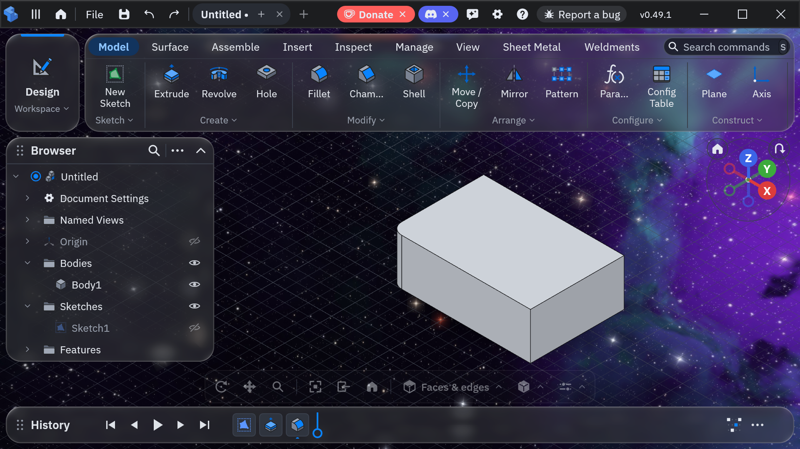

# Liquid Craft

Glass panels for SolidCraft. Every panel, bar and dialog fill becomes a pane of glass over
what is behind it (the 3D view): frosted, bent like a lens near the rim, with a specular
edge and a hairline border. Two themes: **Liquid Craft** (light) and **Liquid Craft Dark**.

This is the stock-SolidCraft version of the 0.48 all-in-one "Liquid Craft" look. It uses the
plugin API (themes@0.1 and shaders@0.2) and needs SolidCraft 0.49.1 or newer.

## Install

1. Open Preferences > Plugins.
2. Click Install plugin... and pick `liquid-craft-3.0.0.zip`.
3. Turn the plugin on with its check box on the card.

## Use

- **Theme:** pick Liquid Craft (light) or Liquid Craft Dark in Preferences > Appearance.
  The themes appear after the built-in ones while the plugin is on.
- **Glass:** on the plugin card, turn on "Panel backdrop: Liquid glass". Without it the
  themes draw flat, see-through fills.
- **Turning it off:** the glass is a setting of the plugin card, not of the theme, so picking
  another theme keeps it on. To remove it, go to Preferences > Plugins and untick
  "Panel backdrop: Liquid glass" on the Liquid Craft card (or untick the plugin itself).

## Settings (the card)

| Setting | Range | Default | What it does |
|---|---|---|---|
| Blur (%) | 0 to 200 | 85 | How frosted the glass is. 100 is the blur the shader was written for; the blur radius itself is fixed. |
| Rim bend (%) | 0 to 200 | 100 | How hard the glass bends the picture near the rim (the lens). 0 turns the lens off. |
| Rim reach (%) | 0 to 100 | 50 | How far the lens bend reaches into the middle of the pane. 0 keeps it at the rim; 100 spreads it through the pane. |
| Accent tint (%) | 0 to 100 | 0 | 0 is clear glass with a faint white lift. Rising values tint the glass with the theme's accent colour. |

The card shows the values as plain numbers with two decimals.

## Differences from the 0.48 all-in-one version

- Light or dark is chosen in Preferences > Appearance, not by a switch on the card.
- The glass is a second step: turn on "Panel backdrop: Liquid glass" on the card.
- The See-through slider is gone. Its effect is baked into the theme files' fill alphas.
- The blur radius is fixed (24 px in the manifest). The Blur slider mixes sharp and blurred
  images instead of changing the radius, and the 8-tap ring and mip pyramid are gone.
- No drop shadow under floating panes.
- No smoothed (squircle) corners: panels keep the host's plain rounded corners.
- No text colour flip or halo: text does not change colour with the brightness behind it.
  The theme fills were made more transparent so text stays readable on both themes.
- Light theme only, legibility (`liquid-craft.json`, before -> after): the tab title and app bar
  labels use `app_bar_text` #2c3340 (was the light base's #e6eaf2, light text on a dark title bar);
  the ribbon group captions use `text_dim` #3a404c (was the light base's #6e7480); the ribbon
  `toolbar` fill is #ffffffc0 (was #ffffff3e, the SPEC value). The floating view toolbar at the
  bottom centre fades to 45 % when the pointer is away from it, and at that strength its icons and
  labels are faint over a busy background. It is fully readable when the pointer is on it. To keep
  it readable all the time, set Preferences > Navigation > When idle to Always visible. The dark
  theme is unchanged.
- The clear/accent switch is now the Accent tint slider (0 to 100 %).
- Glass applies only to panels whose theme fill is see-through. The dimmed backing behind a
  modal dialog keeps the app's plain blur. Nothing is drawn in safe-graphics mode or when the
  OS asks for reduced transparency.
- The card's labels and values follow SolidCraft 0.49.1 (plain sliders, two decimals).

## Files

- `plugin.json`: the manifest (id `liquid-craft`).
- `liquid-craft.json`, `liquid-craft-dark.json`: the two themes.
- `liquid-glass.wgsl`: the panel shader.
- `LICENSE`: MIT. Includes the notice for the egui-glass code the shader is derived from.
